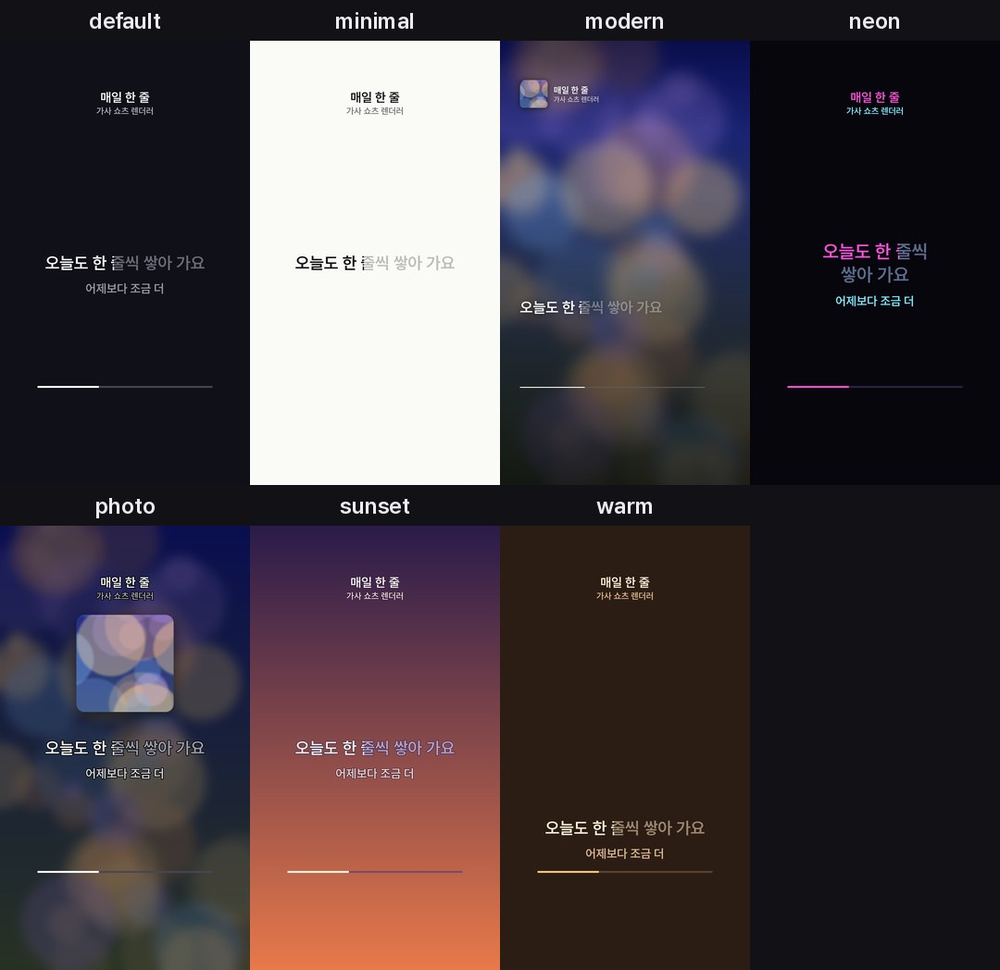

# lyrics-shorts-render
쇼츠메이커(수동)

가사 파일(LRC) + 음원 + 배경 사진으로 **세로형(1080x1920) 가사 쇼츠 영상**을 만드는 도구입니다.
노래방처럼 부르는 만큼 글자가 채워지고, 곡 제목·앨범 아트·음악 반응 막대를 넣을 수 있으며,
쇼츠 앱 버튼에 가사가 가려지지 않는지 확인해 줍니다.

진행 계획은 [ROADMAP.md](ROADMAP.md), 날마다 한 일은 [DEVLOG.md](DEVLOG.md)에 있습니다.

---

## 1. 설치

필요한 것: **Python 3.10 이상**, **ffmpeg**, 그리고 파이썬 패키지 두 개(Pillow, numpy).

```
# ffmpeg — macOS: brew install ffmpeg / Ubuntu: sudo apt install ffmpeg / Windows: winget install ffmpeg
pip install -r requirements.txt
```

한글 폰트는 컴퓨터에 깔린 것(나눔·Noto CJK·맑은 고딕·Apple SD 고딕 등)을 자동으로 찾습니다.
원하는 폰트가 있으면 `--font 폰트.ttf` 또는 환경변수 `SHORTS_FONT=폰트.ttf`.

## 2. 바로 해보기 (예시 곡)

저장소에 들어 있는 예시(`examples/demo/`)로 장면 하나와 영상을 만들어 봅니다.

```
python3 -m shorts frame examples/demo/demo.json --at 0:04       # examples/demo/demo.png
python3 -m shorts render examples/demo/demo.json --preview      # demo-1.preview.mp4, demo-2.preview.mp4
```

## 3. 내 노래로 만들기

### ① 가사 타이밍 파일(LRC) 준비

이미 LRC 파일이 있으면 건너뜁니다. 없으면 **`tools/lrc-sync.html`** 을 브라우저(폰도 됨)로 엽니다.

1. 음원 파일을 고르고, 가사를 한 줄에 한 줄씩 붙여넣기
2. 노래를 틀고 각 줄이 시작될 때 **다음 줄 시작** 탭 (`쉼` = 앞 줄을 여기서 끝냄, `취소` = 마지막 탭 되돌리기)
3. 노래방 효과를 원하면 **탭 단위 → 단어마다(노래방)** 로 바꾸고 단어마다 탭
4. **LRC 파일 저장**

탭은 소리를 듣고 조금 늦게 누르게 돼서 0.15초 앞당겨 기록합니다(바꿀 수 있음). 파일은 브라우저 밖으로
나가지 않고, 작업 중인 내용은 브라우저에 남아 있어 다시 열어도 이어서 할 수 있습니다.

**자동으로 맞추기:** 가사 텍스트만 있으면 음성 인식으로 타이밍을 자동으로 잡을 수도 있습니다
(`pip install faster-whisper` 필요, 처음 한 번 모델을 내려받음). 인식이 틀린 글자는 무시하고 가사 텍스트에
맞추므로 가사만 정확하면 됩니다. 발음·뜻 파일을 주면 가사 아래 작은 줄로 같이 나옵니다(줄 수가 같아야 함).

```
python3 tools/autosync.py 노래.mp3 가사.txt --sub 발음.txt --sub 뜻.txt --language ja -o 노래.lrc
```

LRC는 이런 모양의 글자 파일입니다. 메모장으로 고쳐도 됩니다.

```
[ti:곡 제목]
[ar:가수]
[00:12.00]일반 줄은 이렇게
[00:15.50]<00:15.50>노래방 <00:16.10>줄은 <00:16.60>단어마다 <00:17.40>시각을
[00:19.00]
```

빈 줄(`[00:19.00]`)은 앞 줄이 거기서 끝난다는 뜻입니다. 같은 시각의 줄이 여러 개면 첫 줄이 가사, 나머지는 그 아래
작게 보이는 보조 줄(발음·번역)입니다 — 색은 스타일의 `sub_colors`, 크기는 `sub_font_size`.

### ② 곡 설정 파일 만들기

옵션을 매번 치지 않도록 JSON 하나에 적어 둡니다(LRC와 같은 폴더에 `노래.json`). 경로는 이 파일 위치 기준.

```json
{
  "lyrics": "노래.lrc",
  "audio": "노래.mp3",
  "bg": "배경.jpg",
  "cover": "앨범.jpg",
  "style": "photo",
  "start": ["0:45", "1:30"],
  "duration": 20
}
```

- `bg`에는 사진 대신 짧은 영상(mp4·mov·webm·gif)을 줄 수 있습니다. 곡 길이만큼 반복 재생되고, 스타일의 흐림(`bg_blur`)·어둡게(`bg_dim`·`bg_shade`)가 그대로 입혀집니다
- `start` 여러 개 = 쇼츠 여러 개(`노래-1.mp4`, `노래-2.mp4`). 하나만 쓰면 `"start": "0:45"`
- 시간은 `45`, `"0:45"`, `"1:02.5"` 모두 됩니다
- `title`/`artist`를 적으면 LRC의 `[ti:]`/`[ar:]` 대신 그 글자를 화면 위쪽에 씁니다(빈 문자열이면 숨김)
- 쓸 수 있는 항목: `lyrics audio bg cover font style title artist start duration fps preview out`

### ③ 장면 확인 — 쇼츠 앱에 가려지지 않는지

```
python3 -m shorts frame 노래.json --at 0:50 --guide
```

`노래.png`에 쇼츠 앱의 위쪽 메뉴·오른쪽 버튼·아래쪽 제목 자리가 반투명 빨강으로 표시됩니다.
가사·앨범 아트·진행 바가 그 자리에 걸리면 `주의:` 메시지가 나옵니다(`render`도 같은 검사를 합니다).

### ④ 빠른 미리보기 → 최종 렌더

```
python3 -m shorts render 노래.json --preview    # 절반 해상도·15fps, 몇 초면 끝 (노래-1.preview.mp4 ...)
python3 -m shorts render 노래.json              # 최종본 (노래-1.mp4 ...)
```

렌더 중에는 `렌더 중 42% · 남은 시간 약 3초`가 보입니다. 명령줄 옵션은 설정 파일보다 우선합니다:

```
python3 -m shorts render 노래.json --start 1:10 --duration 15 --style neon -o 시험.mp4
```

### ⑤ (선택) 자막 파일로 내보내기

```
python3 -m shorts export 노래.json                 # 노래.srt — 유튜브 자막·대부분의 편집기
python3 -m shorts export 노래.json --format ass    # 노래.ass — 글꼴·색·위치·노래방 채우기까지
```

설정 파일에 구간(`start`)이 있으면 쇼츠마다 0초 기준으로 맞춘 자막이 나옵니다(`노래-1.srt` ...).

## 4. 꾸미기

### 내장 스타일



```
python3 -m shorts styles
```

| 이름 | 느낌 |
|---|---|
| `modern` | 요즘 음악 쇼츠 느낌: 왼쪽 정렬 굵은 가사, 부드러운 그림자, 왼쪽 위 Now Playing 카드(`bg`·`cover`와 함께) |
| `default` | 어두운 남색 배경, 흰 글자 |
| `minimal` | 흰 배경 검은 글자, 다음 줄·진행 바 없이 깔끔하게 |
| `neon` | 검은 배경에 형광 분홍·하늘색, 노래방 하이라이트가 잘 보임 |
| `photo` | 배경 사진용(`bg`와 함께): 흐리고 어둡게 + 천천히 확대 + 글자 테두리 |
| `sunset` | 보라→주황 노을 그라데이션 배경 |
| `warm` | 따뜻한 갈색 배경, 가사를 화면 아래쪽에 |

### 내 스타일

바꾸고 싶은 값만 적습니다. 설정 파일의 `"style"`에 바로 적거나, 따로 `내스타일.json`으로 저장해
`"style": "내스타일.json"` / `--style 내스타일.json`으로 씁니다.

```json
{
  "extends": "neon",
  "text_color": "#FFE066",
  "font_size": 84,
  "transition": "slide",
  "reveal": "typewriter",
  "visualizer": true
}
```

자주 쓰는 항목(전체 목록은 `shorts/frame.py`의 `Style`):

| 항목 | 뜻 | 예 |
|---|---|---|
| `text_color` / `next_color` / `unsung_color` | 지금 줄 / 다음 줄 / 노래방에서 아직 안 부른 글자 색(`#RRGGBBAA`로 투명도) | `"#FFFFFF"` / `"#FFFFFF59"` |
| `font_size` / `next_font_size` | 글자 크기(px) | `72` / `52` |
| `font_path` | 폰트 파일(스타일 파일 위치 기준) | `"fonts/나눔.ttf"` |
| `center_y` | 가사 세로 위치(0 위 ~ 1 아래) | `0.5` |
| `bg_color` / `bg_gradient` | 배경색 / 아래쪽 색(주면 그라데이션) | `"#2A1B4A"` / `"#E8794A"` |
| `bg_blur` / `bg_dim` / `bg_zoom` | 배경 사진 흐림(px) / 어둡게(0~1) / 천천히 확대 정도 | `22` / `0.5` / `0.08` |
| `stroke_width` / `stroke_color` | 글자 테두리 | `3` / `"#000000"` |
| `transition` / `fade` | 줄 바뀜 효과 `fade`·`slide` / 걸리는 시간(초) | `"slide"` / `0.3` |
| `reveal` | `typewriter`면 한 글자씩 나타남 | `"typewriter"` |
| `visualizer` | 음악 반응 막대(음원 있을 때) | `true` |
| `cover_shape` / `cover_size` | 앨범 아트 모양 `rounded`·`circle`·`square` / 크기 | `"circle"` / `420` |
| `text_align` / `margin_x` | `center`·`left`(왼쪽 정렬) / 왼쪽 여백 | `"left"` / `0.08` |
| `shadow` / `shadow_blur` | 글자 그림자 진하기(0~1) / 번짐(px) — 테두리보다 부드러움 | `0.6` / `12` |
| `sub_font_path` / `info_font_path` | 보조 줄 / 곡 정보 폰트(원문은 일본어 폰트, 발음·뜻은 한글 폰트처럼) | `"fonts/Pretendard-Medium.ttf"` |
| `info_layout` | `center`(가운데 큰 제목) / `card`(왼쪽 위 작은 앨범 아트 + 제목·가수) | `"card"` |
| `bg_shade` | 배경 아래쪽을 점점 어둡게(글자 자리만 가라앉힘) | `0.7` |
| `sub_font_size` / `sub_colors` | 보조 줄(발음·번역) 크기 / 색 목록(줄마다 차례로) | `38` / `["#FFD27F", "#FFFFFF"]` |
| `show_next` / `show_info` / `progress_bar` | 다음 줄 / 곡 정보 / 진행 바 보이기 | `false` |

## 5. 명령 한눈에

| 명령 | 하는 일 |
|---|---|
| `python3 -m shorts render 노래.json` | 영상(mp4) 만들기. `--preview` 빠른 미리보기 |
| `python3 -m shorts frame 노래.json --at 0:50` | 한 장면 PNG. `--guide` 쇼츠 가림 영역 표시 |
| `python3 -m shorts export 노래.json` | 자막(SRT/ASS) |
| `python3 -m shorts styles` | 내장 스타일 목록 |

설정 파일 대신 LRC를 직접 줘도 됩니다: `python3 -m shorts render 노래.lrc --audio 노래.mp3 --bg 배경.jpg --style photo`.
모든 옵션은 `python3 -m shorts render --help`.

## 6. 문제 해결

- **글자가 네모(□)로 나와요** → 한글 폰트를 못 찾은 것. `--font 나눔고딕.ttf`처럼 지정하세요
- **`ffmpeg`를 찾을 수 없어요** → ffmpeg를 설치하고 터미널을 다시 여세요(1. 설치 참고)
- **`주의: 가사이(가) 쇼츠 앱의 '오른쪽 버튼' 자리에 걸려요`** → `frame --guide`로 보고, 스타일의
  `font_size`를 줄이거나 `max_text_width`(기본 0.68)를 줄이세요
- **음악 막대가 안 보여요** → 스타일에 `"visualizer": true`와 함께 음원(`audio`)이 있어야 합니다
- **노래방 효과가 안 나와요** → LRC 줄에 단어 시각(`<00:15.50>단어`)이 있어야 합니다. 싱크 도구의 "단어마다" 모드로 만드세요

## 개발

```
python3 -m unittest discover -s tests -t .   # 테스트
python3 tools/bench.py                        # 3분 반 곡 렌더 속도·메모리 측정
python3 tools/gallery.py                      # 스타일 미리보기 그림(docs/gallery.jpg) 다시 만들기
```
